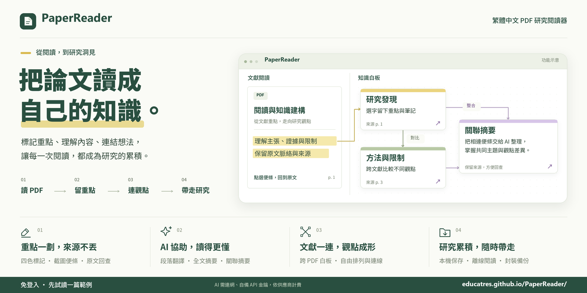

# PaperReader

[](https://educatres.github.io/PaperReader2/)

[](https://creativecommons.org/licenses/by-nc/4.0/deed.zh-hant)

[開啟 PaperReader](https://educatres.github.io/PaperReader2/) · [GitHub](https://github.com/educatres/PaperReader2)

[使用指引（PPTX，含範例操作截圖）](docs/PaperReader_使用指引.pptx)

繁體中文的私人研究工作台：**讀 PDF → 選字標記 → 來源便條 → 翻譯與摘要 → 知識白板 → 可攜備份**。

前端可直接部署 GitHub Pages，所有 AI 供應商均由瀏覽器直接連線。沒有登入、遠端資料庫、分析追蹤或代管 API 代理。

## 使用

1. 開啟「我的專案」，建立並命名專案；進入後匯入 PDF，或點「先試讀一篇範例」。既有研究升級後會保留為第一個專案。
2. 螢光筆模式下跨行選字，放開滑鼠就會建立一組標記與便條。跨頁請分開標記。文字選取以灰色顯示，與黃色螢光標記區分；選「手掌模式」可拖曳移動 PDF，翻頁按鈕與頁碼位於閱讀面板上方。
3. 拖曳便條標題整理白板；從四邊的連接點拖到另一張卡片，建立人工研究關係。雙擊連線可修改。白板左上工具列可用黑、藍、綠、紅四色手寫，以整筆橡皮擦刪除筆畫，或拉框選取多筆後拖移／按 Delete 刪除；背景可切換淡色方格或橫線紙。
4. 點「連接你的 AI」，選擇 OpenAI、CGU API、Google Gemini、mercuryapi 或 Grok（xAI），貼上自己的 API key，再選擇模型與測試連線。OpenAI／CGU 可直接選 `gpt-6-luna`、`gpt-5.6-luna`，或輸入自訂模型 ID；推理程度可選低／中／高，預設為中。Gemini 與 Grok 使用模型預設推理。
5. 點便條翻譯／摘要，或確認全文摘要的文字傳送範圍。
6. 定期匯出目前專案的 `.researchpack`，包含 PDF、標記、筆記、連線與視角。從總覽匯入會建立新專案；文獻庫的「還原研究封裝 / JSON」經確認後取代目前專案。
7. 文件列右側可「隱藏工具列」以增加閱讀空間；按同一位置的「展開工具列」可恢復。收合狀態會記住，手機版以箭頭圖示操作。
8. 點選一張已連線的便條，再按白板上方「關聯摘要」，或便條選單的「摘要這組關聯」。預覽這組便條與連線後確認，即可生成不同風格的紫色整合便條。
9. PDF 工具列選「截圖模式」，在單頁內拖曳框選，放開即建立截圖便條；Esc 取消。點圖片可放大，點「輸入或貼上文字」填入自己的內容。
10. PDF 工具列可「隱藏 PDF 面板」，讓白板佔滿寬度；文件列的「顯示 PDF」可恢復。按「在新視窗閱讀」可獨立閱讀，也可從文獻庫為各篇 PDF 另開視窗。
11. 白板右上可「隱藏知識白板」，讓 PDF 佔滿寬度；文件列的「顯示知識白板」可恢復。按「在新視窗開啟白板」可開出多個白板，分別查看不同位置。
12. PDF 工具列按「逐段翻譯」，先查看本機辨識的段數及預估請求數，再開始翻譯。完成後，滑鼠移到段落旁的標註圖示即可查看中文。
13. 按 PDF 工具列的橡皮擦「刪除 PDF 標註」，再點選螢光標註或翻譯圖示即可刪除，按 Esc 結束。刪除螢光標註會保留便條、原文、翻譯、摘要、筆記、連線及來源頁定位；可使用復原／重做。刪除翻譯備註會移除該段譯文與任務中的片段，相關執行中任務會暫停，可手動接續其餘段落；需再次開始翻譯才會重新生成已刪除的段落。刪除狀態隨本機保存與研究備份保留。

### 多專案管理

「我的專案」是完整專頁，可建立、搜尋、排序、重新命名、刪除與進入不同研究。卡片顯示 PDF 數、便條數與最後修改時間；名稱可重複，以獨立 ID 辨識。

每個專案各有文獻庫、白板、標記、附件、翻譯與摘要進度。按「← 我的專案」或瀏覽器上一頁時，會先保存編輯器內容與待存修改、暫停本視窗的 AI 任務，再離開；儲存失敗會留在原專案，可重試或下載本視窗草稿。PDF 匯入與備份等操作進行時會暫時阻止切換。閱讀位置、PDF 縮放／旋轉、面板配置與白板視角按專案保存，重開時可接續。

其他視窗繼續留在自己的專案。全文摘要、逐段翻譯與段落辨識在各專案內分別互斥，不同專案可同時執行。同一份備份可匯入多次，即使內部 PDF、便條或圖片 ID 相同，也會成為獨立專案。

備份預設「匯入為新專案」。選擇「還原研究封裝 / JSON」才覆蓋目前專案；「清空目前專案」保留名稱、ID 與建立時間。刪除專案會連同它的附件與草稿移除，其他專案保留。JSON 不包含附件，只可沿用目前專案內符合雜湊與大小的原檔，否則顯示缺檔提示；完整搬移請使用研究封裝。專案被其他視窗刪除時會停止編輯，可先下載本視窗未儲存草稿。

所有專案仍保存在此網站來源的瀏覽器內，共用儲存額度；沒有登入或雲端同步。API Key 留在原分頁記憶體，切換時可沿用，重新整理後需重填。升級會以同一交易移轉舊研究、PDF、截圖、進度與草稿；失敗完整回復原資料。升級後請重新整理舊分頁。已快取應用程式與附件後，可離線進入總覽、切換及閱讀本機專案，AI 功能需要網路。

### PDF 逐段翻譯

同頁同欄的相鄰文字行合併為段落，跨頁與跨欄分開翻譯。沿用五家 AI 供應商設定，一次處理一個段落；只在按下開始、接續或重新翻譯後傳送該段原文，開啟文件與查看譯文不呼叫 API。全文摘要維持原有流程。

標註小窗只顯示完整繁體中文譯文，緊貼該段翻譯圖示上方，保留約 8px 間距；上方空間不足時就近放在該段下方，避開正在閱讀的原文段落。優先利用緊鄰的留白縮短小窗，長內容可在窗內捲動與選取；相鄰段落密排時仍保持靠近圖示，不跳到遠處留白。點圖示固定、點外側或按 Esc 關閉。Tab 聚焦圖示可開啟譯文，再按 Tab 進入小窗捲動。觸控裝置點圖示即可閱讀。管理介面可隱藏圖示，不刪除已保存的譯文。

翻譯進度與成功的子片段會保存，可暫停、手動接續；重新整理後需在執行視窗重新輸入金鑰。單一研究空間同時只允許一個逐段翻譯任務，主畫面與獨立 PDF 視窗均可操作。重新翻譯會再次產生用量，新譯文完整保存前仍保留舊版。

段落辨識依 PDF 文字位置推估，複雜表格、方向異常與不可靠區域列為待檢查；重複頁首頁尾、純頁碼與部分公式排除。掃描 PDF 需要 OCR，本版不執行 OCR，也不傳送圖片。翻譯品質仍需核對原文。

譯文是 PaperReader 閱讀器的標註疊加層，原始 PDF 檔案維持原樣。完整研究封裝與 JSON 均保存段落、譯文、白板筆畫及進度，Markdown 輸出原文與譯文；JSON 不含 PDF 或截圖附件。新版匯出格式為 v3，支援匯入舊 v1／v2 研究，舊程式不保證能讀取 v3。升級後請重新整理所有閱讀視窗，再繼續編輯。

### 多視窗閱讀

可同時開啟多個 PDF 閱讀視窗與多個知識白板，也能用多個視窗閱讀同一篇 PDF 的不同頁面。開出閱讀視窗後，主畫面的 PDF 面板會自動收起；閱讀視窗的「研究白板」可另開獨立白板。關閉主畫面後，其他視窗仍可閱讀、編輯及保存資料。

新白板會從開窗當下的位置與縮放開始，之後各自拖曳、縮放、搜尋與選取，不會帶動其他白板。位置會在該視窗重新整理或隱藏／顯示後恢復。從同時顯示 PDF 的主畫面開出白板時，原視窗會收起白板；若原本只顯示白板，則保留原白板，方便再開一個視角。兩個面板至少保留一個顯示。

同一瀏覽器設定檔、同一網站來源且同一專案的視窗，共用文獻、螢光標記、截圖、便條、連線、白板筆畫與已保存的 AI 結果。各視窗獨立保留選取文獻、頁碼、縮放、旋轉、工具模式、格線、白板視角與面板配置。復原／重做只操作該視窗建立的修改；便條「定位原文」優先送到最近使用、正在閱讀該篇 PDF 的閱讀視窗，沒有可用視窗時顯示主畫面的 PDF。

在獨立 PDF 視窗或已隱藏白板的主畫面點擊螢光標記，只會讓最近使用且正在顯示的白板定位該便條，其他白板維持自己的位置。

不同欄位的修改會自動合併；同一欄位發生衝突時，保留目前資料與本機草稿，點提示可比較、下載草稿或選擇版本。其他視窗刪除來源時，也會保留編輯中的未儲存草稿。還原／清空會更換研究空間版本，舊視窗的修改不能直接寫回。未處理的衝突草稿請另外下載保存，研究封裝僅包含已保存的研究內容。

便條 AI 與全文摘要在主畫面或白板視窗操作；PDF 逐段翻譯也能在獨立閱讀視窗操作。每個專案的全文摘要與逐段翻譯各自只允許一個視窗執行；關閉執行視窗後，可在其他適用視窗重新輸入金鑰、接續已保存的片段。API Key 仍只在輸入金鑰的分頁記憶體內，不傳給其他視窗。無痕視窗、不同瀏覽器與不同網站網址各有自己的資料，不會互通。

### PDF 截圖便條

框選只擷取 PDF 畫布，不含螢光標記或介面，支援目前的縮放、旋轉與螢幕像素比例。單次限同一頁，過小的框選、取消操作不建立便條。截圖保留來源頁碼與未旋轉頁面的正規化區域，右下箭頭可回到原頁框選位置。

新便條的文字與筆記**完全留白**，由使用者自行輸入或貼上；不執行 OCR，也不自動擷取框內 PDF 文字。圖片便條可移動、調整寬度、收合、改標題、連線、隱藏、刪除及復原／重做。

**圖片不作 AI 分析。** 單張便條翻譯／摘要只傳送自行填入的文字與筆記，沒有文字時停用。關聯摘要沿用文字與連線屬性，圖片未提供且無文字的便條會標記內容缺失；整組都沒有文字時不發出請求。程式明確列出可傳送的文字欄位，不傳送圖片二進位、Base64、Blob URL、附件 ID 或圖片附件。

PNG Blob 保存在此瀏覽器的 IndexedDB，單張上限 20 MB。完整 `.researchpack` 包含圖片並驗證 SHA-256、PNG 檔頭、尺寸及大小；JSON 只保存文字、來源與附件資訊，Markdown 只輸出文字及來源說明。從 JSON 還原但本機沒有圖片時，顯示缺圖提示，文字仍可使用。完整圖片請使用研究封裝搬移。為支援各視窗復原，刪除便條後不立即刪除圖片；關閉所有視窗後，下次開啟時才清理未被便條或衝突草稿引用的圖片。清空或刪除專案會一併刪除該專案的圖片。

### 關聯便條摘要

摘要範圍為選取便條所屬的連通群組，包含直接與間接連線，排除已隱藏的便條及其連線。群組可跨不同 PDF，至少需要兩張相連便條。箭頭方向不限制尋找群組，但會原樣交給 AI 分析。

AI 會收到這組便條的原文、既有翻譯／摘要、人工筆記、標籤、來源文件名稱與頁碼，以及每條連線的**關係類型、補充說明、來源／目標與方向**。提示要求整合共同主題、保留對比與矛盾、區分延伸與待驗證事項，並以 `[N1]` 便條代號及 `[R1]` 關係代號回查來源。人工連線不代表事實已獲證實，AI 結果仍需自行核對。

紫色摘要便條可編輯、移動、收合、加入筆記及備份，來源按鈕可跳回各便條。「來源快照」保留生成當時的內容與連線；來源後續修改不會自動更新摘要，可按「再次整合」預覽目前群組並生成另一張摘要。刪除來源後，歷史快照仍保留，對應來源按鈕停用。摘要便條不自動新增研究關係線。

每次整合執行一個生成請求，使用目前設定的供應商、模型與推理程度，執行中可取消。單次輸入上限為 60,000 字元（含結構與標籤）；超過時請拆分群組或縮短內容，程式不會自動截斷。取消或失敗不會新增空白便條，可重新執行。金鑰沿用分頁記憶體保存方式。

### Grok（xAI）連線

Base URL 為 `https://api.x.ai/v1`。在「連接你的 AI → Grok（xAI）」貼上從 [xAI Console](https://console.x.ai/) 取得的 API key，按「使用此金鑰」即可自動查詢可用語言模型。程式只列出支援文字輸入與輸出的模型，保留仍可用的既有選擇，否則選取清單第一個模型；也可手動輸入模型 ID。

模型偵測只查詢 `/language-models`，不產生文字生成用量。「測試連線」、翻譯、段落摘要、關聯摘要與全文摘要使用 Responses API，設定 `store: false`。不同 Grok 型號支援的推理參數不同，因此目前使用模型預設推理，不傳送 `reasoning.effort`。金鑰只暫存分頁記憶體，重新整理後需重新輸入；供應商與模型選擇會保留。詳見 [xAI 官方 API 文件](https://docs.x.ai/developers/rest-api-reference/inference/responses)。

### mercuryapi 連線

Base URL 為 `https://air.cgu.edu.tw/mercuryapi/v1`。在「連接你的 AI → mercuryapi」填入自己的 API key，按「使用此金鑰」即自動查詢可用模型，並保留仍可用的既有選擇，否則選用清單第一個模型。可從下拉選單更換、手動輸入模型 ID，或按「自動偵測模型」重新查詢；清單為空時會提示確認模型權限。

模型偵測只查詢 `/models`；「測試連線」使用所選模型送出一則簡短的 Responses 文字請求，會產生少量用量。翻譯與摘要也使用此設定。金鑰只暫存分頁記憶體，重新整理後需重新輸入；供應商與模型選擇會保留。金鑰取得與帳戶權限請參考 [mercuryapi 官方說明](https://air.cgu.edu.tw/mercuryapi/)。

### CGU 連線

依 [CGU 官方文件](https://air.cgu.edu.tw/workspace4/LLMAPI/api_call.html)，Base URL 為 `https://air.cgu.edu.tw/cgullmapi/v1`，使用 `Authorization: Bearer 金鑰` 與 Responses API。請先到 [CGU API Key 頁面](https://air.cgu.edu.tw/workspace4/LLMAPI/index.php) 啟用、複製金鑰。可直接貼上純金鑰，或包含 `Bearer`／`Authorization: Bearer` 前綴。

CGU 已支援 CORS，程式一律由瀏覽器以 HTTPS 直接連線。

1. 在「連接你的 AI → CGU API」貼上自己的 CGU API key，按「驗證 CGU 金鑰」。此步只查詢 `/models`，不送出文字生成。
2. 選擇模型與推理程度，按「測試連線」進行少量用量的 Responses 文字測試。
3. 完成設定後即可翻譯便條、產生段落摘要或全文摘要。

舊版連線方式設定會被忽略，供應商、模型與推理偏好保留。重新整理網站後需重新輸入金鑰。401 表示金鑰驗證失敗；403 也可能是模型權限或 Token／美元額度；404 應確認模型及 Responses 端點支援。自訂模型須支援 Responses，僅支援 Chat Completions 的模型目前不適用。

## 隱私與本機儲存

| 資料 | 保存方式 |
| --- | --- |
| PDF 原檔 | 此瀏覽器的 IndexedDB |
| PDF 框選截圖 | 此瀏覽器的 IndexedDB，獨立 PNG Blob |
| 文字索引、標記、便條、關係、白板筆畫、可接續摘要、衝突草稿 | 此瀏覽器的 IndexedDB |
| 模型 ID、推理程度與閱讀預設 | 此瀏覽器的 localStorage，沒有金鑰 |
| 各視窗文獻、頁碼、縮放、旋轉、工具模式、白板視角與配置 | 各視窗的 sessionStorage，沒有金鑰 |
| API key | **只暫存目前分頁記憶體** |

金鑰不寫入 localStorage、sessionStorage、IndexedDB、檔案、GitHub 或備份；重新整理／關閉分頁後清除。所有供應商均直接由瀏覽器連線。呼叫雲端 API 時，金鑰須以 HTTPS 授權標頭傳給官方供應商驗證。

已暫存的 API Key 在設定中以 `***` 表示；按「清除本機 API Key」可立即清除目前供應商在本分頁記憶體中的金鑰及尚未套用的輸入，保留 PDF 與研究便條。其他供應商的金鑰分別管理。

Gemini 成功取得模型清單後，若可用文字模型中包含 `gemini-flash-lite-latest`，會預設選用它；若沒有，會清空模型選擇並提示自行選擇。可從模型選單選取或輸入自訂 ID；取得清單失敗時保留原先的模型選擇。

- 翻譯／段落摘要只傳送該便條原文，沒有原文時使用該便條的人工筆記。
- 截圖便條的翻譯／摘要使用自行輸入的文字與筆記，不傳送或分析圖片；建立截圖不觸發 AI。
- 關聯摘要確認後，只傳送預覽群組的便條文字與連線屬性，不傳送其他群組或原始 PDF。
- 全文摘要先取得明確同意，再傳送**當前 PDF 的分塊文字**。不傳送原始 PDF、其他文獻或整個工作區。
- OpenAI／CGU／mercuryapi 使用 Responses API，設 `store: false` 與 `reasoning.effort`；Grok 同樣使用 Responses API 與 `store: false`，推理採模型預設。此設定不取代供應商的資料處理與保留政策。Gemini 使用 `generateContent`，不傳送 OpenAI 專用推理參數。
- PDF、便條與 AI 回應都作為不可信內容處理。模型沒有工具權限，回應以 React 文字呈現，不執行 HTML。
- 所有 JavaScript、PDF worker、字型、CJK 字元映射及 WebAssembly 隨網站提供，沒有第三方 CDN。CSP 限制連線至同源、OpenAI、CGU／mercuryapi 與 Gemini API 網域。
- 模型清單由官方接口取得；清單可見不代表具備文字任務權限，請測試。使用者承擔供應商計費。
- 瀏覽器金鑰輸入適用於個人 BYOK 使用。請使用可信電腦、瀏覽器與擴充功能；應用程式更新與同源執行的程式碼仍屬信任邊界。

**GitHub Pages 網址不是 localhost。** 網站程式在使用者瀏覽器執行；本機資料屬於 `https://educatres.github.io` 這個網站來源。若改用下方本機指令，資料屬於 `http://127.0.0.1:5173`，兩者不共用；請用研究封裝搬移。清除網站資料、瀏覽器重置或儲存空間遭回收都可能遺失資料，IndexedDB 不能取代下載備份。

## 已實作

- 多 PDF 文獻庫、SHA-256 重複文件辨識、拖放匯入。
- PDF.js 連續閱讀、按可見範圍渲染、縮放、旋轉、跳頁、逐頁文字搜尋。
- 四色螢光筆；保存文件座標、文字範圍、引用上下文與文字雜湊。縮放時重建文字錨點，保存正規化矩形作為後援。
- PDF 單頁框選截圖、圖片便條與放大預覽、留白文字、自行輸入／貼上、縮放及旋轉後回查框選位置、圖片本機儲存與完整備份。
- 一次有效選取建立一組標記／便條，在 IndexedDB 交易內一併保存並合併其他視窗的變更。PDF ↔ 便條雙向定位。
- 無邊際白板、卡片拖曳與調整寬度、收合、自由筆記、標籤搜尋、Shift 多選、連線、方向與關係標籤、小地圖、復原／重做；另支援四色手寫、整筆橡皮擦、多筆框選／拖移／刪除，以及淡色格線／橫線紙背景。
- 分開保存原文、可編輯翻譯、可編輯 AI 摘要與人工筆記。只隱藏卡片與刪除來源標記分開操作。
- OpenAI／CGU／Gemini 個別分頁金鑰、動態模型清單、指定模型選單、自訂模型 ID、推理程度、文字連線測試、取消及可理解錯誤。
- 長文 map-reduce 摘要、原始頁碼範圍、進度、分塊結果保存、中斷後接續。任務綁定送出時的供應商、模型與推理程度；舊備份缺少推理設定時以中接續。
- 關聯群組 AI 整合、關係類型／說明／方向、來源與關係代號、紫色摘要便條、可回查來源、歷史內容快照、取消與重試。
- Markdown、帶 schemaVersion 的 JSON、`.researchpack` ZIP 封裝匯入匯出；驗證結構、關聯、大小、路徑、PDF SHA-256。
- 完整載入並完成 Service Worker 快取後，可離線重新開啟閱讀與編輯。AI 須連網。新版本不強制重新整理研究中的分頁。
- 桌面分割視窗、可拖曳比例、可收合的頂部工具列、窄螢幕閱讀／白板切換、鍵盤操作及原生 dialog 焦點限制。

## 本機開發

使用 **Node.js 24 或更新版本**。目前的 PDF.js 要求較新的 Node，Windows 舊版 Node 的打包工具也可能異常退出。

```sh
npm ci
npm run dev
```

開啟 `http://127.0.0.1:5173`。開發與預覽伺服器都只綁定 `127.0.0.1`。Windows PowerShell 若禁止 `npm.ps1`，請改用 `npm.cmd ci`、`npm.cmd run dev`，不必調低系統執行原則。

```sh
npm test
npm run build
npm run preview
```

建置結果位於 `dist/`。`base: './'` 適用 GitHub Pages 專案子路徑。Vite 設定會自動複製本機 PDF.js 資源至 `public/pdfjs/`；此產物不納入 Git。

## GitHub Pages

儲存庫為 `educatres/PaperReader2`，發布網址為 <https://educatres.github.io/PaperReader2/>。

在 Repository → Settings → Pages，將 Source 設為 **GitHub Actions**。推送 `main` 後，`.github/workflows/deploy.yml` 會執行安裝、單元測試、型別檢查、建置及發布。**不用設定任何 API key 或 GitHub Secret。**

## 驗證

```sh
npm test
npm run test:e2e
```

瀏覽器測試預設使用已安裝的 Microsoft Edge。其他系統可將 `playwright.config.ts` 的 `channel` 改成 `chromium` 並安裝 Playwright Chromium。可透過 `TEST_BASE_URL` 測試既有部署，例如 GitHub Pages 子路徑。

多專案測試涵蓋空狀態、建立／改名／搜尋／排序、切換保存與失敗、過期 AI 回應、同 ID 重複匯入、附件／草稿隔離、刪除墓碑、跨視窗刪除、離線與手機操作，以及舊版資料移轉、配額失敗回復與舊客戶端清表隔離。

測試涵蓋跨行標記、縮放與旋轉、持久化與雙向定位、人工筆記與連線、封裝備份／還原、四個供應商的 API 格式、模型選單與推理參數、429／連線失敗恢復、金鑰不落盤、長文摘要重新整理後以原推理設定接續、舊設定遷移、工具列收合與窄螢幕展開、離線還原、20 頁雙欄 PDF 按需渲染及掃描 PDF 提示。API 測試使用攔截回應，**不會讀取私人金鑰或產生真實 API 費用**。

CGU 直連測試涵蓋舊連線設定相容性、Bearer 貼上格式、驗證／生成分流、401／403／404、模型未開放、重新整理清除金鑰與匯出不含憑證；所有 API 回應均為模擬資料。

關聯摘要另驗證間接連通與循環、隱藏便條隔離、方向與關係類型保留、內容上限、紫色卡片與來源定位、復原／重做、備份還原、失敗／取消／重試，以及來源移除後的歷史快照相容性。

截圖測試包含實際裁切像素、縮放／旋轉／高像素密度、反向拖曳與頁面邊界、Esc／微小框選、文字留白、單張及混合群組純文字請求、全空白群組停用、圖片復原／重做、離線重載、封裝完整還原、缺圖／損毀拒絕及 JSON 缺圖提示。資料庫測試覆蓋舊版升級、附件生命週期與儲存失敗。

多視窗測試涵蓋兩側面板收合、多白板的獨立視角與重載恢復、指定白板聚焦、窄螢幕開窗操作、開窗阻擋備援、同篇／不同篇 PDF 獨立閱讀、同時標記、各自復原／重做、來源定位、關閉主視窗後繼續操作、欄位合併與衝突草稿、還原／清空的舊編輯防護、全文摘要任務鎖、截圖附件復原及離線重載。

白板手寫測試涵蓋四色選擇、連續繪製、整筆擦除、框選多筆、群組拖移、Delete、復原、淡色格線／橫線切換與重新整理後保存。

## 限制

- 目前不包含 OCR、向 AI 傳送原始 PDF／圖像、AI 自動推薦關係、簡報／白板圖像輸出、多人協作與跨裝置同步。
- 掃描 PDF 可閱讀，但無文字層就無法精準標註。密碼 PDF 請先解除保護。
- 雙欄、圖表、公式的文字擷取可能不完整。摘要頁碼表示分塊來源範圍，**不是經查證的逐句引用**。
- 單份 PDF 上限 150 MB；匯入封裝壓縮檔上限 200 MB、解壓總量上限 300 MB；JSON 上限 30 MB。可攜封裝最多 50 份文件。
- JSON 只有文字註記、文件與截圖 metadata，缺少 PDF 時須附加同一原檔，完整截圖需從 researchpack 還原。Markdown 是閱讀輸出；重新還原請用 JSON 或 researchpack。
- 用量顯示為供應商回傳的最後一次回應 tokens；不是全文所有分塊、重試與整合的總帳單。全文開始前的 tokens 數為粗估。
- 已在 Edge Chromium 驗證；Firefox、Safari 仍需進一步測試。

## 專案結構

```text
src/components/   PDF 閱讀器、白板、研究便條、AI 設定與對話框
src/lib/          PDF 載入、錨定、API adapters、IndexedDB、封裝驗證
src/store.ts      交易式變更、自動保存、各視窗歷史與雙向定位
src/types.ts      版本化資料模型
tests/            核心資料與瀏覽器驗收測試
public/           本機範例 PDF、圖示與建置時複製的 PDF.js 資源
```

本版部署於 GitHub Pages，金鑰只暫存記憶體；所有供應商由前端以 HTTPS 直接連線。

介接參考：[OpenAI Responses](https://developers.openai.com/api/reference/resources/responses/methods/create)、[OpenAI Models](https://developers.openai.com/api/reference/resources/models/methods/list)、[Gemini generateContent](https://ai.google.dev/api/generate-content)、[Gemini Models](https://ai.google.dev/api/models)。第三方授權見 [THIRD_PARTY_NOTICES.md](./THIRD_PARTY_NOTICES.md)。

## 授權

Copyright © 2026 [educatres](https://github.com/educatres)。除另有標示外，本專案的原創程式碼、文件與展示圖採用 [Creative Commons 姓名標示－非商業性 4.0 國際（CC BY-NC 4.0）授權](https://creativecommons.org/licenses/by-nc/4.0/deed.zh-hant)。

- 可為非商業目的分享、重製及修改。
- 使用時須適當標示作者、提供授權連結，並註明是否修改。
- 商業使用須另行取得著作權人許可。

建議標示方式：`PaperReader by educatres — CC BY-NC 4.0 — https://github.com/educatres/PaperReader2`；若有修改，請另行註明。

完整條款見 [LICENSE](LICENSE)。第三方套件、字型與其他另有授權的素材沿用各自的授權，詳見 [THIRD_PARTY_NOTICES.md](THIRD_PARTY_NOTICES.md)。使用者匯入的 PDF 與其他內容，其權利仍屬原著作權人，不因使用本工具而改變。
